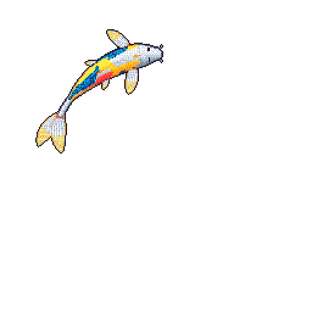

  
  

  
    
  
  &nbsp;&nbsp;
  
  &nbsp;&nbsp;
  
    
  

 

  

 

  

 

<h3 align="center"><code>~/contributions</code></h3>

  <picture>
    <source media="(prefers-color-scheme: dark)" srcset="https://raw.githubusercontent.com/sidd-a03/sidd-a03/output/github-contribution-grid-snake-dark.svg">
    <source media="(prefers-color-scheme: light)" srcset="https://raw.githubusercontent.com/sidd-a03/sidd-a03/output/github-contribution-grid-snake.svg">
    
  </picture>
   
  

 

